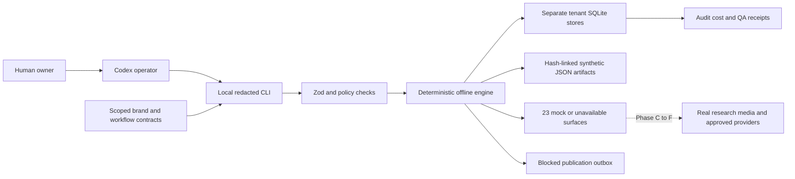

# Architecture — multi-tenant GTM OS

## Core boundaries

Human Owner ↔ Codex Operator ↔ audited skills/role specs ↔ typed workflow engine ↔ policy/claim/approval gate ↔ adapter ↔ X / analytics / GitHub (where explicitly permitted). Research and creative jobs may operate offline with fixtures.

Data: `tenant_id` required on every content object, account mapping, approval, evidence/source card, analytics event, artifact, job and audit receipt. Identity is asserted at adapter boundary, not inferred from visible browser tab. Job table + outbox + idempotency keys; local SQLite for MVP, external queues/database only if capacity justifies it.

## Context model

`AGENTS.md` is scoped always-on governance; `SKILLS.md` human index; actual `SKILL.md` progressive on-demand instructions; `agents/roles` are task roles (do not assume background bots); `WORKFLOWS.md` human process map; YAML definitions are machine-validated work contracts; `DESIGN.md` human creative contract; `tokens.json` validates rendered output.

## Threat boundaries

External website/skill = untrusted source; output must pass evidence and injection tests. Credentials = protected environment outside LLM. Public publishing = explicit human gate + verified user identity + content hash + projected spend. Marketing claims = cited and scoped to time and jurisdiction.

## Implemented execution boundary — Phase B

The Python governance validator and local evidence tooling remain active. Phase B adds the typed CLI/core, tenant storage and mock boundaries below. This is an on-demand local app, not a deployed service or scheduler.

Schemas own typed contracts; core owns definition/input validation, transitions and checkpoints; storage owns transactional repositories, source links and audit/cost/outbox records; policy owns unconditional execution denial and a constraint-only approval matcher; connectors/adapters own capability, identity, cost, dry-run and audit interfaces. Operator-defined roles remain instruction contracts, not independent background processes. Beads owns task state in its separate local Dolt database.

SQLite migration 1 uses WAL/FULL synchronization, per-tenant files and metadata/SQL constraints. Immutable sources, scoped input fingerprints, original audit events and artifact file digests make restart/replay inspectable. Actual synthetic API charges are zero; model/compute costs remain unmeasured. Audit chains are not externally signed or anchored against a local database owner.

Real source ingestion, creative rendering, authenticated accounts, signed human approvals, provider reconciliation, live analytics and campaign simulations remain C–F work. No scheduler, model call, renderer, provider request or verified live identity is implied. See PHASE_B.md and ADRs 0001–0004 for interfaces, tested failures and these limits.
