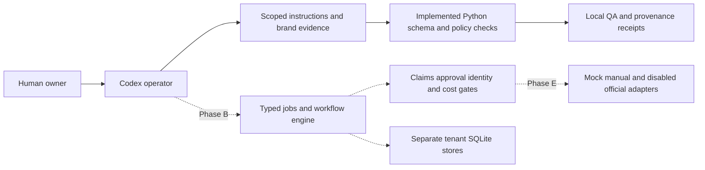

# Architecture — multi-tenant GTM OS

## Core boundaries

Human Owner ↔ Codex Operator ↔ audited skills/role specs ↔ typed workflow engine ↔ policy/claim/approval gate ↔ adapter ↔ X / analytics / GitHub (where explicitly permitted). Research and creative jobs may operate offline with fixtures.

Data: `tenant_id` required on every content object, account mapping, approval, evidence/source card, analytics event, artifact, job and audit receipt. Identity is asserted at adapter boundary, not inferred from visible browser tab. Job table + outbox + idempotency keys; local SQLite for MVP, external queues/database only if capacity justifies it.

## Context model

`AGENTS.md` is scoped always-on governance; `SKILLS.md` human index; actual `SKILL.md` progressive on-demand instructions; `agents/roles` are task roles (do not assume background bots); `WORKFLOWS.md` human process map; YAML definitions are machine-validated work contracts; `DESIGN.md` human creative contract; `tokens.json` validates rendered output.

## Threat boundaries

External website/skill = untrusted source; output must pass evidence and injection tests. Credentials = protected environment outside LLM. Public publishing = explicit human gate + verified user identity + content hash + projected spend. Marketing claims = cited and scoped to time and jurisdiction.

## Execution note

Phase A implements Python governance validation and local evidence tooling. No GTM runtime packages or integrations exist yet. The runtime below is a Phase B–F target, not an installed service.

Implemented components: `scripts/validate_scaffold.py` owns parsing and declaration checks; `scripts/schemas/governance.json` owns Phase A contracts; fixture tests verify failure cases; audit/inventory scripts produce local evidence. Beads owns task tracking in separate embedded Dolt state. Codex operates these components on demand; there is no daemon or scheduled job.

Planned runtime ownership: schemas define typed contracts; core owns transitions/checkpoints; storage owns transactional tenant repositories; policy owns claims/approval/spend vetoes; connectors own explicit capabilities/identity/cost/dry-run/audit boundaries. These boundaries must be tested before a runtime capability is reported as working. See ADRs 0001–0003 for accepted design decisions.
